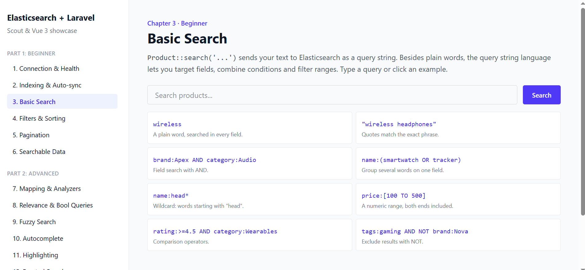
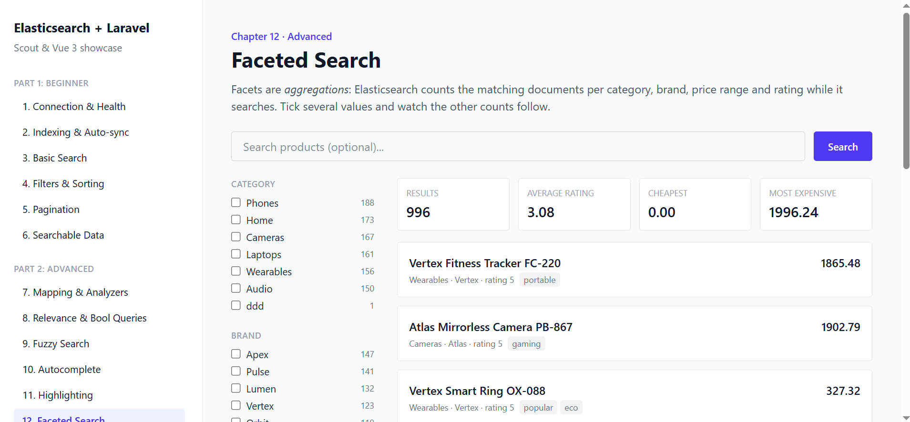
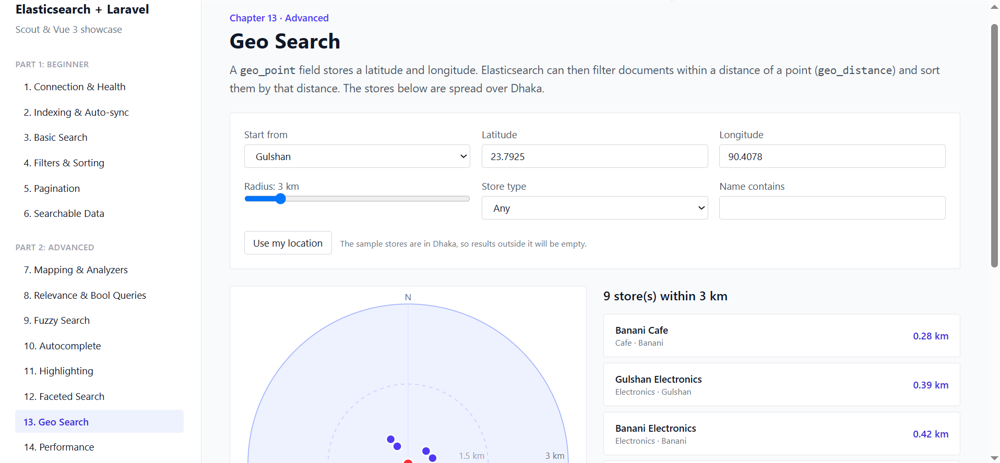

# Laravel Elasticsearch

[](https://github.com/tfevan/laravel-elastic-search/actions/workflows/ci.yml)


A hands-on, chapter by chapter guide to **Elasticsearch** built with **Laravel 13**, **Laravel Scout** and
**Vue 3 + TypeScript**. Every chapter is one working page in the app, backed by a small, tested API endpoint, so you can
read the code, click through the demo and see the Elasticsearch request behind it.

No authentication, no unnecessary abstractions: the goal is to show how Elasticsearch features map to clean,
production-style Laravel code.

## Screenshots

| Search and relevance | Faceted search | Geo search |
|----------------------|----------------|------------|
|  |  |  |

## What you will learn

- Setting up Elasticsearch with Laravel Scout, and indexing a database with seeders and Elastic migrations.
- Designing mappings (`text` vs `keyword`, explicit mapping, strict dynamic mapping) and custom analyzers.
- Full text search, filters, sorting and pagination, and the 10,000 result window.
- Relevance tuning: boosts, `bool` queries and the `_explain` API.
- Typo tolerance, "did you mean" suggestions and autocomplete with edge n-grams.
- Highlighting matches safely in a Vue UI (no `v-html`).
- Faceted search with aggregations, and geo search with distance filters and sorting.
- Performance: `search_after` with a point in time, queued indexing and zero-downtime reindexing with aliases.
- Testing search code against a real Elasticsearch cluster, locally and in CI.

## Chapters

The app has a sidebar with one entry per chapter. Chapters 1 to 6 are the beginner path, 7 to 15 are advanced.
Each chapter also has a short write-up in [`docs/chapters`](docs/chapters).

| # | Chapter | Route | Level | Topics |
|---|---------|-------|-------|--------|
| 1 | Cluster health | `/health` | Beginner | Talking to the cluster, status, graceful errors |
| 2 | Indexing and CRUD | `/products` | Beginner | Scout, models in the index, create, update, delete, index summary |
| 3 | Search | `/search` | Beginner | Full text search with `multi_match` |
| 4 | Filters and sorting | `/filters` | Beginner | Category and brand filters, price range, sorting |
| 5 | Pagination | `/pagination` | Beginner | `from` and `size`, page window limits |
| 6 | Documents | `/documents` | Beginner | Reading raw documents, the raw search response, activating products |
| 7 | Mapping and analyzers | `/mapping` | Advanced | Mappings, analyzers, the `_analyze` API, synonyms |
| 8 | Relevance and bool queries | `/relevance` | Advanced | Boosts, `must`, `should`, `filter`, `must_not`, `_explain` |
| 9 | Fuzzy search and suggestions | `/fuzzy` | Advanced | Fuzziness, prefix length, phrase suggester |
| 10 | Autocomplete | `/autocomplete` | Advanced | Edge n-gram analyzer, search as you type |
| 11 | Highlighting | `/highlight` | Advanced | Highlight fragments, rendering them without `v-html` |
| 12 | Faceted search | `/facets` | Advanced | Aggregations, `post_filter`, per-facet counts |
| 13 | Geo search | `/geo` | Advanced | `geo_point`, `geo_distance`, distance sorting, distance rings |
| 14 | Performance | `/performance` | Advanced | `search_after` and PIT, queued indexing, alias reindexing |
| 15 | Testing | `/testing` | Advanced | Feature tests, integration tests on a real cluster, CI service container |

## Tech stack

- **Backend:** PHP 8.3+, Laravel 13, Laravel Scout, `babenkoivan/elastic-scout-driver` and `elastic-scout-driver-plus`,
  `babenkoivan/elastic-migrations`
- **Search:** Elasticsearch 9.x
- **Frontend:** Vue 3, TypeScript, Vue Router, Vite, Tailwind CSS
- **Quality:** Laravel Pint, Larastan (level 6), PHPUnit, Vitest, vue-tsc, GitHub Actions, Dependabot

## Requirements

- PHP 8.3 or newer with Composer
- Node.js 20 or newer
- Elasticsearch 9.x (local install on Windows, or Docker)

## Getting started

### 1. Run Elasticsearch

Choose one option.

#### Option A: Docker

```bash
docker compose up -d
```

This starts a single node Elasticsearch 9 with security disabled, available at `http://localhost:9200`.

#### Option B: Local install (for example Windows 10)

Download Elasticsearch from the [official site](https://www.elastic.co/downloads/elasticsearch), extract it and edit
`config/elasticsearch.yml`.

By default Elasticsearch 9 enables security and serves HTTPS. For local development, turn off security and HTTPS:

```yaml
xpack.security.enabled: false
xpack.security.http.ssl.enabled: false
```

Then start (or restart) Elasticsearch:

```powershell
bin\elasticsearch.bat
```

> **Important:** if you leave `xpack.security.http.ssl.enabled` as `true`, plain `http://localhost:9200` fails with
> `Empty reply from server`, and this app cannot connect. These settings are for local development only. Never disable
> security on a server that is reachable from a network.

Check that it works:

```powershell
curl.exe http://localhost:9200
```

You should see a JSON response with the cluster name and version.

### 2. Install and configure the app

```bash
git clone https://github.com/tfevan/laravel-elastic-search.git
cd laravel-elastic-search

composer install
npm install

cp .env.example .env
php artisan key:generate
```

On Windows PowerShell, use `copy .env.example .env` instead of `cp`.

Make sure these values are set in `.env`:

```env
SCOUT_DRIVER=elastic
ELASTIC_HOST=http://localhost:9200
```

### 3. Create the database, indices and demo data

```bash
php artisan migrate
php artisan db:seed
```

The seeders create about 1000 products and 45 stores in Dhaka, create the Elasticsearch indices with their mappings
(`php artisan elastic:migrate`) and import the data into Elasticsearch (`php artisan scout:import`).

### 4. Run the app

```bash
composer run dev
```

This starts the Laravel server, a queue worker and Vite. Open `http://127.0.0.1:8000` and pick a chapter from the
sidebar.

## Useful commands

| Task | Command |
|------|---------|
| Re-create indices | `php artisan elastic:migrate` |
| Re-import all data | `php artisan scout:import "App\Models\Product"` |
| Code style | `php vendor/bin/pint` |
| Static analysis | `php vendor/bin/phpstan analyse --memory-limit=1G` |
| Backend tests (no Elasticsearch needed) | `php artisan test` |
| Integration tests (real Elasticsearch) | `composer test:integration` |
| Frontend type check | `npx vue-tsc --noEmit` |
| Frontend tests | `npm test` |
| Production build | `npm run build` |

## Testing

The project tests search code in three layers:

1. **Frontend unit tests** with Vitest for pure helpers (highlight parsing, pagination maths, geo offsets).
2. **Backend feature tests** with PHPUnit. Services are mocked, so they cover routes, validation, JSON shapes and error
   handling, and run without Elasticsearch.
3. **Integration tests** against a real cluster, in `tests/Integration`. They use the index prefix `test_`
   (`SCOUT_PREFIX=test_`, enforced in `phpunit.integration.xml`), so your development indices are never touched.
   Start Elasticsearch, then run `composer test:integration`.

GitHub Actions runs everything on every push: PHP 8.3 and 8.4 for Pint, Larastan and feature tests, the frontend
checks, and an integration job that starts Elasticsearch 9 as a service container.

## API overview

All endpoints live under `/api/v1`.

| Area | Endpoints |
|------|-----------|
| Health | `GET /health` |
| Products | `GET/POST /products`, `GET/PUT/DELETE /products/{product}`, `GET /products/index-summary` |
| Search | `GET /search`, `GET /filters`, `GET /filters/options`, `GET /pagination` |
| Documents | `GET /documents/{product}`, `GET /documents/raw`, `PATCH /products/{product}/activation` |
| Relevance | `GET /mapping`, `GET /mapping/analyze`, `GET /relevance`, `GET /relevance/{product}/explain` |
| Text features | `GET /fuzzy`, `GET /autocomplete`, `GET /highlight` |
| Aggregations and geo | `GET /facets`, `GET /geo` |
| Performance | `GET /performance/deep-pagination`, `GET /performance/indexing`, `POST /performance/indexing/touch`, `GET/DELETE /performance/catalog`, `POST /performance/catalog/reindex`, `POST /performance/catalog/rollback` |

## Project structure

```text
app/
  Data/                   Immutable DTOs built from validated requests
  Exceptions/             Domain exceptions mapped to HTTP responses
  Http/
    Controllers/Api/      Thin, invokable controllers
    Requests/             FormRequests with validation rules
    Resources/            API resources
  Models/                 Product and Store (Scout searchable)
  Services/               All Elasticsearch query logic
database/
  elastic/migrations/     Index definitions (mappings, analyzers)
  seeders/                Demo data and index import
docs/chapters/            One write-up per chapter
resources/js/
  api/                    Typed fetch client
  components/             UI building blocks per chapter
  composables/            Data loading logic (state, errors, cancellation)
  pages/chapters/         One page per chapter
  utils/                  Pure, unit tested helpers
tests/
  Feature/                HTTP and service tests (Elasticsearch mocked)
  Integration/            Tests against a real Elasticsearch cluster
```

## Design decisions

- **Thin controllers, logic in services.** Controllers validate, call one service and return JSON. Query building lives in
  `app/Services`, which makes it easy to test.
- **Typed everywhere.** Requests map to readonly DTOs, and the frontend uses TypeScript with explicit API types.
- **Explicit mapping.** Indices use `dynamic: strict`, so unexpected fields fail loudly instead of being guessed.
- **Safe rendering.** Highlighted text is parsed into segments and rendered with normal Vue templates, never `v-html`.
- **Race-free UI.** Composables ignore stale responses or cancel requests, so fast typing cannot show old results.

## Troubleshooting

| Problem | Fix |
|---------|-----|
| `Empty reply from server` on `http://localhost:9200` | Set `xpack.security.enabled: false` and `xpack.security.http.ssl.enabled: false` in `config/elasticsearch.yml` and restart Elasticsearch |
| Health page shows "unreachable" | Check Elasticsearch is running and `ELASTIC_HOST` in `.env` is correct |
| `withSearchableRelations does not exist` | Every searchable model must use `Elastic\ScoutDriverPlus\Searchable` |
| Search returns nothing after seeding | Run `php artisan elastic:migrate` and then `php artisan scout:import "App\Models\Product"` |
| `php vendor/bin/pint` and similar fail on Windows | Use the `php vendor/bin/...` form instead of `vendor/bin/...` |

## License

Released under the [MIT License](LICENSE).

---

Created by [Talha F.](https://talhaf.com/?ref=github-laravel-elasticsearch)